# 用户手册

QuoteFlow 询盘报价平台按岗位分工：产品开发（PD）建询价单、传规格书；采购员邀请供应商、发布、比价、议价、编辑合同；采购主管审批、开标、定标、审核合同；合同批准人批准合同；供应商在门户里查看规格、报价、回复议价；系统管理员维护账号和系统设置（见[管理员手册](管理员手册.md)）。

截图来自演示环境（演示数据 D1–D8，见[验收清单](验收清单.md)）。界面上的时间都是北京时间（UTC+8）。

## 1. 登录与通用操作

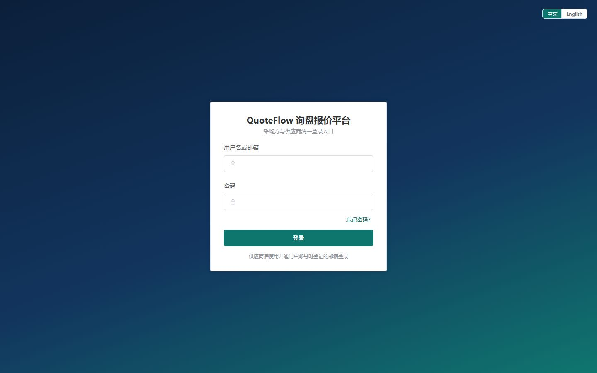

- 浏览器打开系统地址，输入用户名（供应商用开通门户账号时登记的邮箱）和密码。忘记密码点"忘记密码？"，按邮件里的链接重设。
- 右上角切换"中文 / English"：界面立即切换，正在填写的内容不会丢；语言保存到账号，下次登录仍是该语言。
- 右上角用户菜单里可以修改密码、退出登录。
- 同一个 IP 每分钟最多尝试登录 10 次；12 小时没有操作会自动退出。
- 内部用户登录后是**工作台**，集中显示现在需要处理的事项：待我审批、我的草稿 / 被驳回、待发布、等待报价（已响应 N/M）、待开标、议价待处理、待审核 / 待批准合同。每张卡片显示数量和最早的 5 条，"查看全部"进对应的列表。

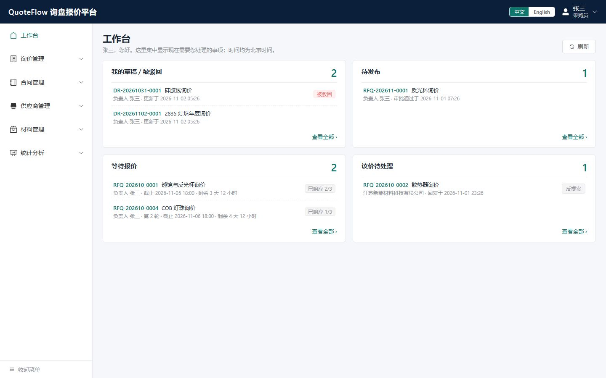

## 2. 产品开发（PD）：建询价单、传规格书

1. 询价管理 › 新建询价单：填项目号（同一项目可以多次询价）、标题、材料类别、币种、负责人（采购员）、PD 负责人和说明，"保存草稿"。
2. **询价行**："从材料库选用"勾选材料并填数量，名称、规格、单位、分类自动带出；没有的物料"添加手工行"；行多时"导入 Excel"（先下载模板，表头不能改）。拖动行首图标调整顺序。
3. **规格书与产品图**：整单规格书（PDF、Excel、图片）上传到"整单规格书"；每一行可以单独上传规格书和产品图。PDF 和图片可以在线预览，Excel 可以表格预览。
4. 检查无误后"提交审批"。提交后不能修改；被驳回会回到草稿，页面顶部显示驳回意见，修改后再提交。

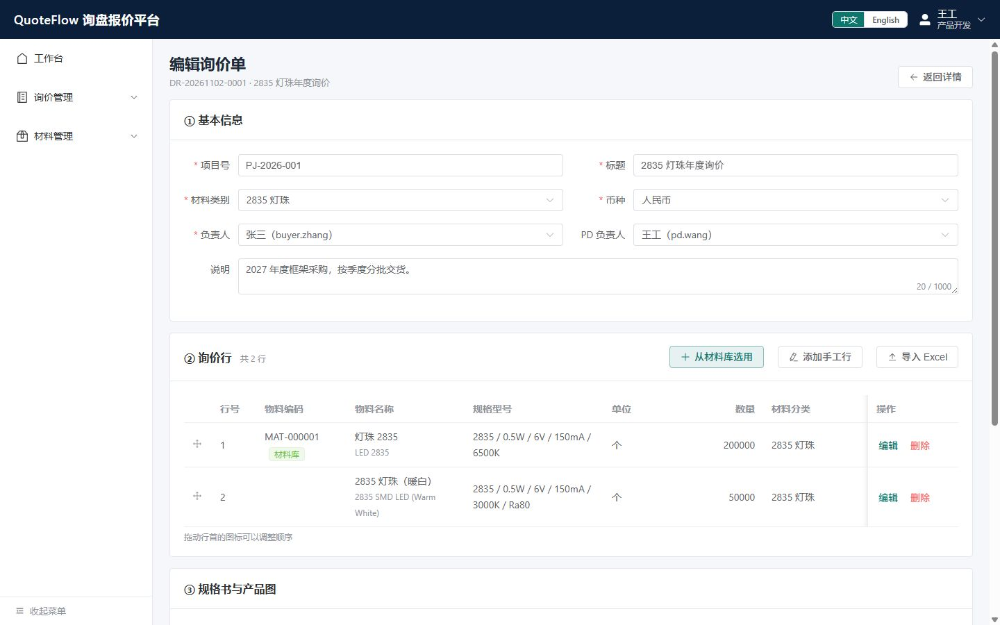

审批通过前，供应商看不到这张询价单的任何信息。

**规格变更**：已发布的询价需要改规格时，在询价单详情点"发起规格变更"，修改询价行和附件，填写变更原因和变更内容，然后交给采购员"通知供应商重新报价"。同一询价号会产生新的一轮，上一轮作废、只读。

## 3. 采购主管：审批

询价管理 › 待我审批（或工作台"待我审批"）打开单据，核对后在右侧"审批操作"里填意见，"通过"或"驳回回草稿"（驳回必须填意见）。通过后生成正式询价号 `RFQ-年月-序号`，负责人和创建人收到邮件。

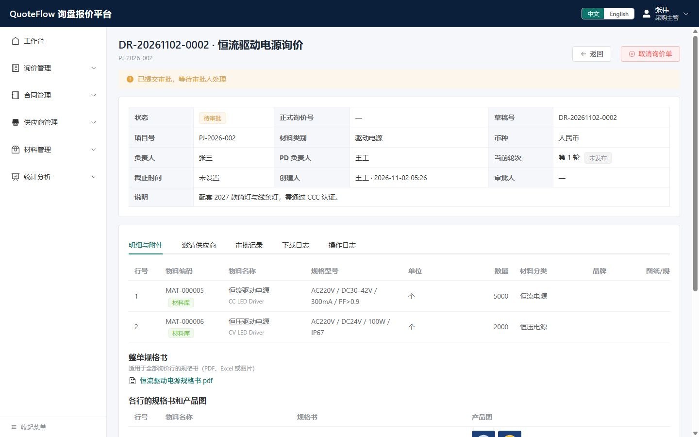

## 4. 采购员：邀请供应商并发布

1. 打开已审批的询价单，"邀请供应商"页签：左边按供应商分类（战略 / 优秀 / 普通）、主营材料、关键字筛选，勾选后"保存名单"。停用的供应商不能选；还没有门户账号的供应商会提示（收到邀请也无法登录报价）。

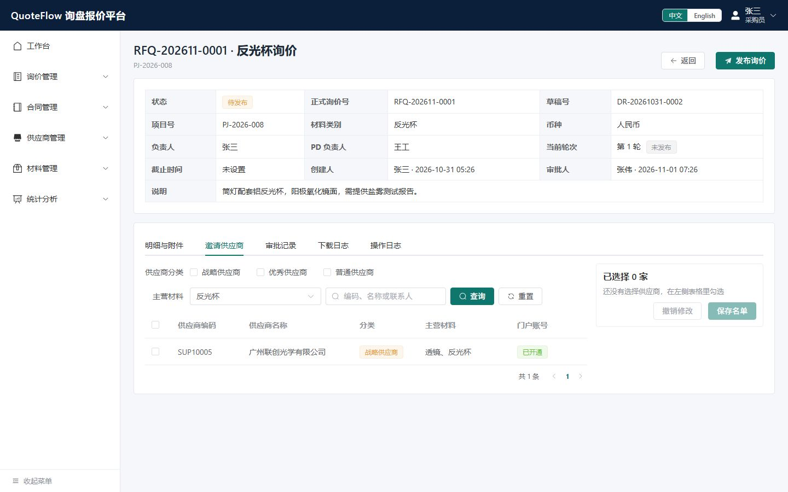

2. 点"发布询价"，选择报价截止时间（可以用"3 天后 18:00"等快捷选项），确认发布。受邀供应商收到邀请邮件（按供应商的语言：中文、英文或中英对照）。

3. 发布后在"供应商响应"页签跟踪：每家的状态（已邀请、已查看、已提交、已拒绝）、首次查看与响应时间、版本数、拒绝原因。**开标前看不到任何报价金额和内容**。对还没响应的供应商可以勾选后"催报"；需要更多时间可以"延期"；遗漏的供应商可以"补充邀请"。

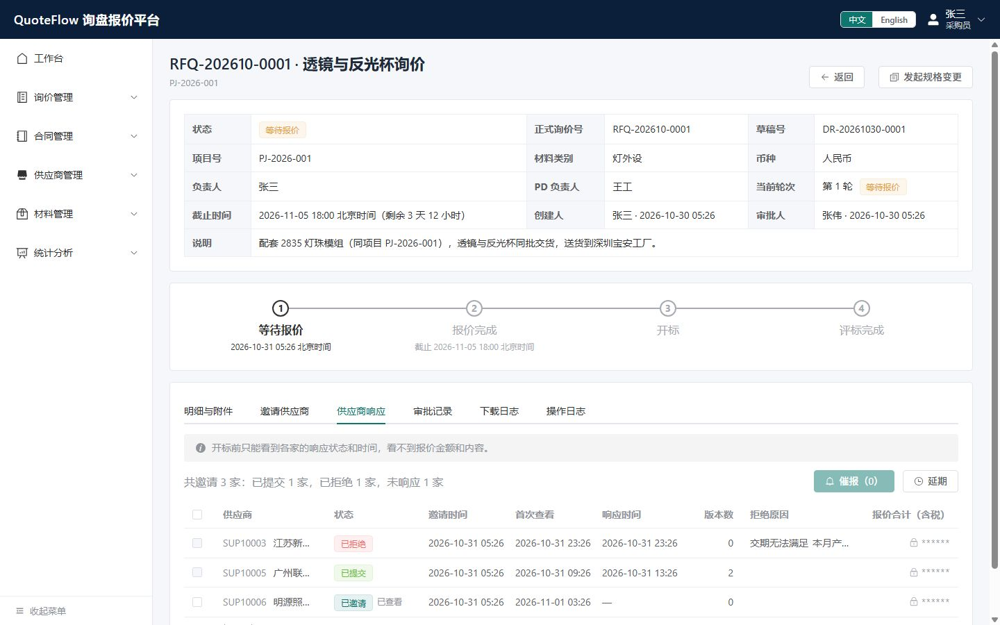

## 5. 供应商：查看规格、报价或拒绝

供应商收到邀请邮件后，点邮件里的链接或登录供应商门户。

1. **首页**列出待报价、议价待回复、最近 30 天的结果；"我的询价"按待处理 / 评标中 / 已结束分页签。

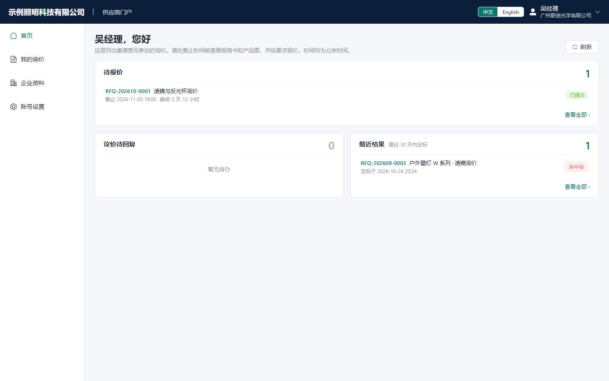

2. 打开询价：查看询价说明、询价明细、规格书与产品图（可以在线预览和下载）、截止时间和采购联系人。
3. **在线报价**：在"我的报价"表格里填写，每行点"编辑全部字段"可以填全部 PPL 字段（中英文对照，带 * 的必填）；合计自动计算。可以先"保存草稿"，确认后"提交报价"。截止前可以多次提交，以最后一次为准；再次提交时写"本次变更说明"。所有版本在"历史版本"里可查。
4. **Excel 报价**：点"下载 Excel 模板"（锁定格式），离线填好后"导入 Excel"，内容进入草稿，核对后"提交报价"。表头被改过、不是本询价下载的模板会被拒绝。
5. **拒绝报价**：点"拒绝报价"，选择原因并填写说明。截止前仍可以改主意重新报价。

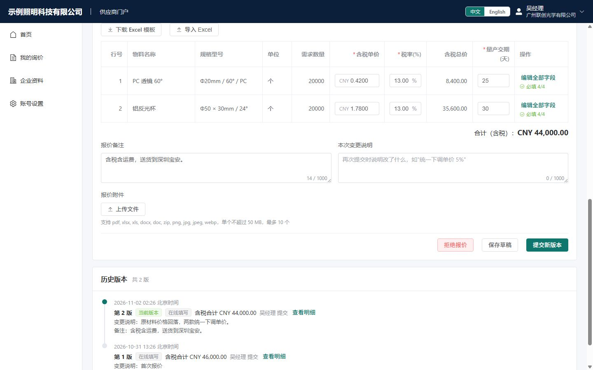

截止后不能再提交或修改。开标后会收到开标通知；入围议价后会收到目标价邮件；定标后显示"恭喜中标"或"本次未中标"。

## 6. 采购主管：提前截止与开标

截止时间到了系统自动进入"报价完成"。所有受邀供应商都已提交或拒绝时，可以在"供应商响应"里"提前截止"。报价完成后点"开标"（不能撤销）：已提交的报价进入评标，供应商收到开标通知，积分自动结算。

## 7. 采购员：比价、入围、议价

1. "比价评标"页签：**汇总**列出各家含税合计（最低价标出）、最长交期、版本、备注 / 拒绝原因；**明细**按询价行横向比较各列，与上一版本相比有变化的单元格高亮。可以"导出 Excel"。

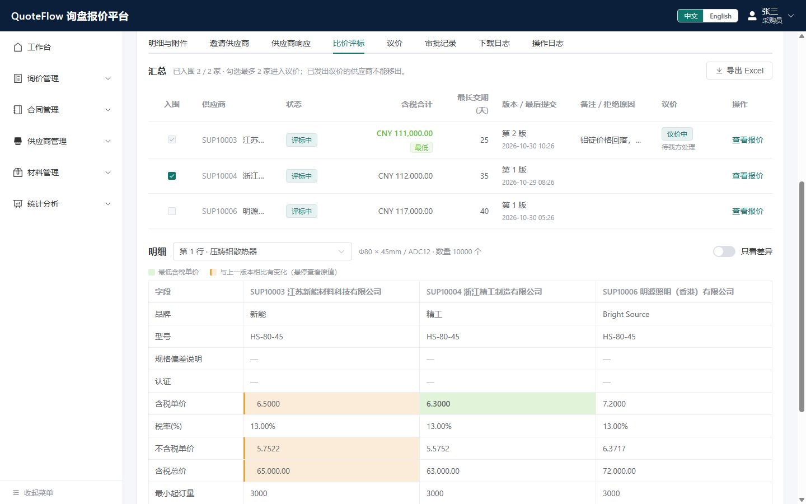

2. 勾选最多 2 家"入围"，"议价"页签出现。
3. **议价**：选择一家，逐行填写目标含税单价、数量或规格说明，写方案说明（可附文件），"发送"。供应商可以接受（成交）、拒绝（须写原因）或提出反提案；对反提案可以接受、继续出价或结束议价。全部往来留痕。成交后系统按成交内容生成新的报价版本，比价矩阵随之更新。

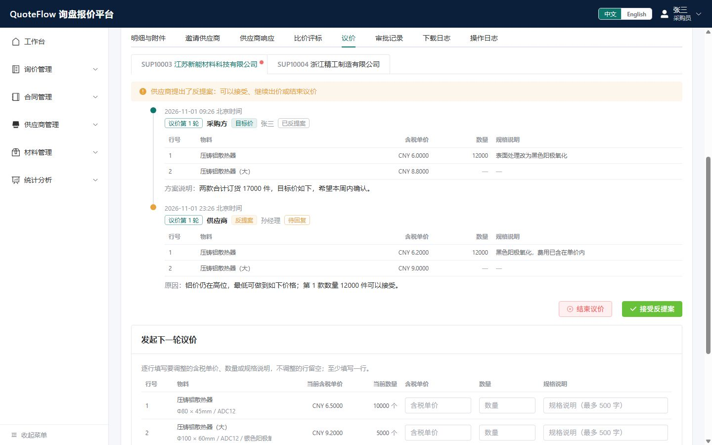

## 8. 采购主管：定标

"比价评标"页签点"定标"，选择 1 家中标供应商，填写定标说明（不会发给供应商），确认。定标后：中标方"已中标"、其他"未中标"，进行中的议价自动关闭，供应商收到结果邮件，自动生成合同草稿，**询价单变为只读**（顶部显示完成横幅）。

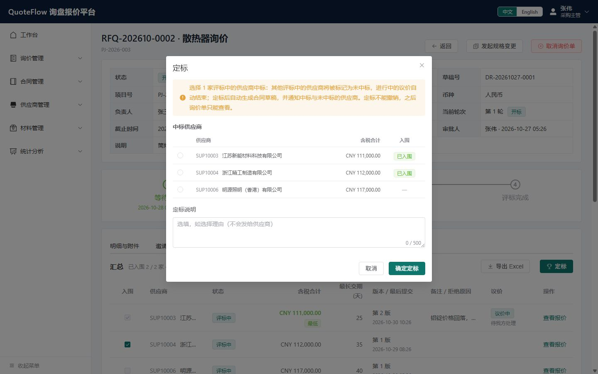

## 9. 合同

合同管理 › 合同列表（或询价单完成横幅里的"查看合同"）。

1. **采购员**：合同草稿带有定标时的询价与报价快照（明细、金额、议价记录、附件）。点"编辑"补充交付日期、交付地点、付款方式、合同摘要和附件，然后"提交审核"。
2. **采购主管**：在右侧"审批操作"审核，通过后转合同批准人；驳回必须写意见，合同回到草稿。
3. **合同批准人**：批准或驳回。
4. 批准后"打印"生成 A4 打印版（人民币合同带大写金额），线下签字盖章后可以上传签字扫描件。本期不做电子签。

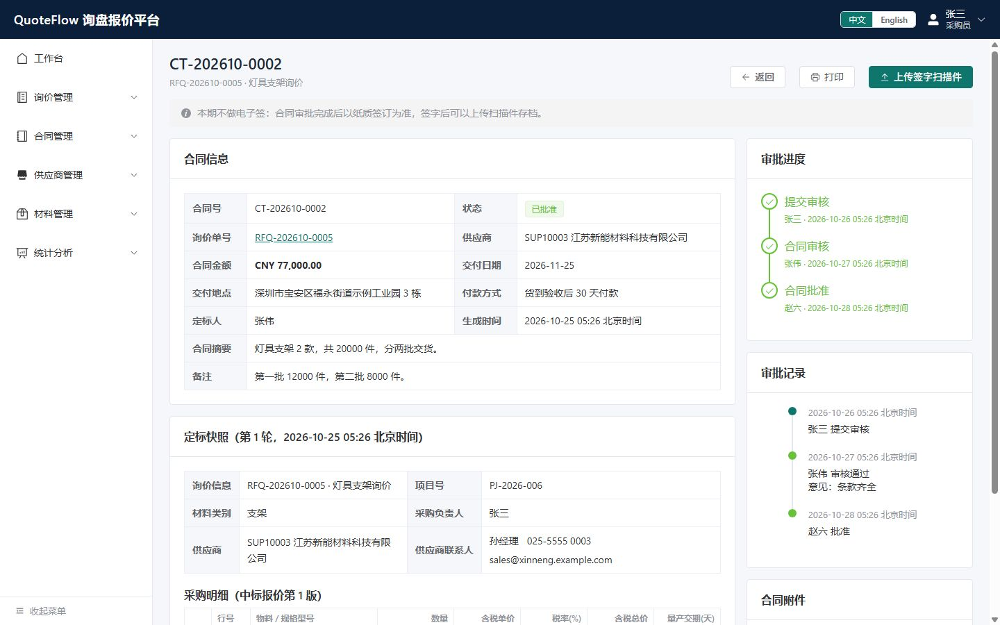

## 10. 统计与报表

统计分析 › 统计看板：年询盘项目数与品类、供应商响应速度、中选次数与成功率、询盘周期时效四张图，可以按日期、材料分类、供应商分类、供应商筛选，每张图可以展开数据表，右上角导出 Excel。

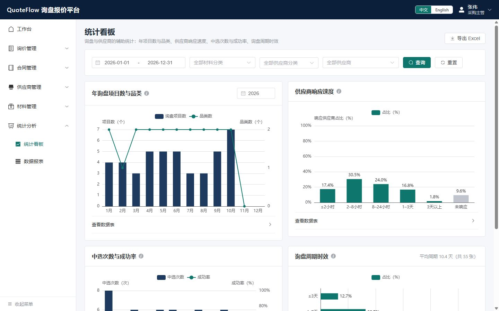

统计分析 › 数据报表：询报价单统计（未开标的轮次金额显示 🔒）、物流报价明细、供应商积分统计、积分记录（采购主管可以手工调整积分，必须写原因）。都可以导出 Excel。

所有统计和报表都按数据权限过滤：采购员只统计自己负责的单据。

## 11. 主数据（采购员、采购主管）

- **供应商管理**：供应商列表（新建、编辑、停用、Excel 导入导出）、供应商详情（基本信息、门户账号、报价记录、积分）、供应商分类（采购主管）。供应商的联系方式属于敏感字段，没有权限的显示 🔒。
- **材料管理**：材料库（名称、规格、单位、分类、图片；新建、编辑、停用、Excel 导入导出）、材料分类（树形，采购主管维护）。停用的材料不能再被询价选用。
